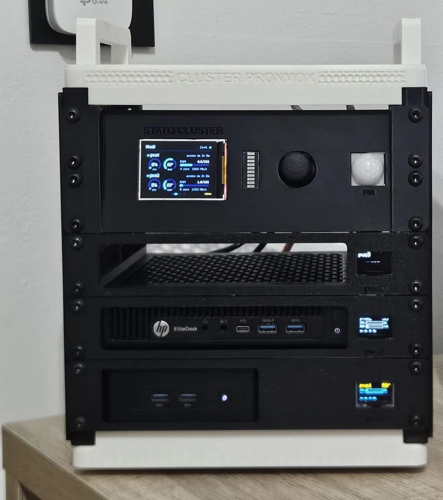
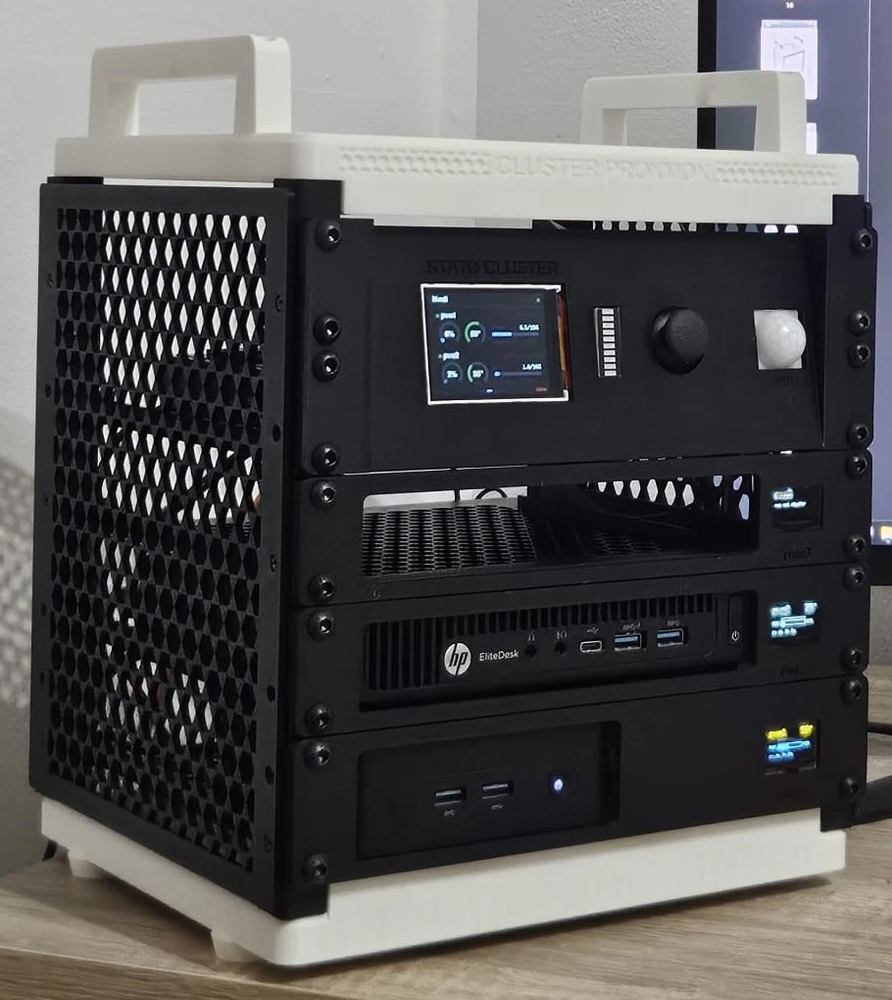
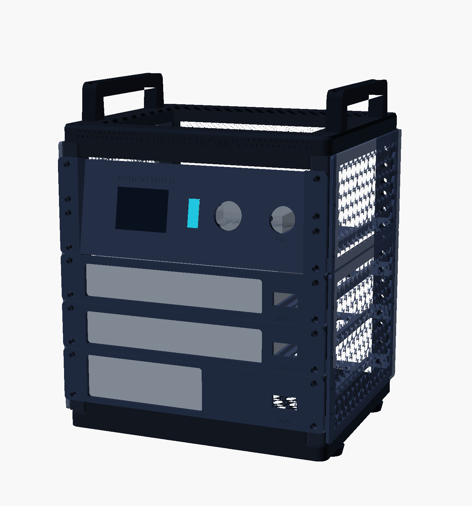

# Mini rack 10" per cluster Proxmox

Armadio da 10 pollici stampato in 3D per **tre mini PC** (un cluster Proxmox), uno **switch di rete** e una **plancia di controllo** con display. Si monta tutto con viti normali, senza colla e senza inserti a caldo.



|  |  |
|---|---|

## Cosa c'è
- **4 vani**:
  - 1 vano alto 51 mm in basso per un Teclast N30;
  - 2 vani da 1U per due HP EliteDesk Mini (G2 e G5);
  - 1 vano da 2U in alto con switch, ESP32 e plancia inclinata.
- **Frontali con display OLED** per ogni PC: nome, temperatura, CPU, RAM e da quanto è acceso. Il vetro del display arriva a filo del frontale.
- **Plancia di controllo inclinata**:
  - display TFT da 2,4" con 5 pagine (panoramica, nodi, macchine, backup e rete, impostazioni);
  - barra a 10 LED con la CPU media del cluster (lampeggia tutta se il cluster perde il quorum);
  - joystick a 4 direzioni: cambia pagina, apre nodi e macchine e, **tenendo premuto 1,5 s**, accende (Wake-on-LAN), riavvia o spegne i nodi e accende, riavvia, spegne o ferma VM e container;
  - impostazioni dal joystick (luminosità, spegnimento schermi da 5 secondi a 30 minuti, scorrimento automatico) salvate nella memoria dell'ESP32: restano anche dopo un riavvio;
  - sensore di movimento PIR, che spegne i display quando non c'è nessuno.
  - Il logo Proxmox non è incluso (è un marchio): senza il file `logo_proxmox.h` il firmware scrive "Proxmox" in testo. Puoi crearlo tu dal media kit ufficiale di Proxmox.
- **Pannelli laterali traforati** a esagoni per l'aria, **maniglie** per trasportarlo e **piedini**.
- Misure: **260 × 220 × 293 mm** circa.
- Si stampa tutto su un piatto da **256 × 256 mm** (Bambu Lab A1, P1, X1).

## Struttura della repo
| Cartella | Cosa contiene |
|---|---|
| `stl/` | Tutti i pezzi da stampare. `__x4` nel nome vuol dire che ne servono 4. `00_rack_montato_solo_da_guardare.stl` non va stampato. |
| `stampa_bambu/` | Progetto Bambu Studio (`.3mf`) con i pezzi già disposti sui piatti. |
| `openscad/` | Sorgente parametrico `rack10.scad`: tutte le misure sono in cima al file. |
| `istruzioni/` | Manuale di montaggio in PDF, passo per passo, con la viteria in scala 1:1. |
| `elettronica/firmware/` | Firmware ESP32 della plancia e due sketch di prova per i fili. |
| `elettronica/server/` | Script per Proxmox che manda lo stato del cluster all'ESP32 via USB. |
| `elettronica/pcb/` | Circuito stampato (facoltativo) che sostituisce la basetta e i fili Dupont. |
| `elettronica/Schema_collegamenti.pdf` | Schema di tutti i fili. |
| `script/` | Script Python che rigenerano il manuale e il progetto Bambu. |

## Pezzi da stampare
| N. | Pezzo | Quanti | Colore usato |
|---|---|---|---|
| 01 | Montante | 4 | Nero |
| 03 | Cornice sotto | 1 | Bianco |
| 04 | Cornice sopra | 1 | Bianco |
| 05 | Pannello laterale destro | 1 | Nero |
| 06 | Pannello laterale sinistro | 1 | Nero |
| 09 | Maniglia | 2 | Bianco |
| 10 | Piedino | 4 | Bianco |
| 11 | Ripiano HP | 2 | Nero |
| 12 | Ripiano pve1 (Teclast) | 1 | Nero |
| 13 | Ripiano plancia (switch + ESP32) | 1 | Nero |
| 14 | Frontale pve1 | 1 | Nero |
| 15 | Frontale pve2 | 1 | Nero |
| 16 | Frontale pve3 | 1 | Nero |
| 17 | Plancia inclinata | 1 | Nero |
| 18 | Barra fermo switch | 1 | Nero |

In tutto sono **24 pezzi in PLA**. I numeri 02, 07 e 08 non esistono: sono pezzi di versioni precedenti.

**Impostazioni consigliate**:
- PLA, strati da 0,2 mm, 3 pareti e riempimento al 15-20%;
- nel `.3mf` i pezzi sono già disposti e orientati sui piatti: controlla nell'anteprima se qualcuno ha bisogno di supporti;
- tieni il rack lontano da sole e fonti di calore, perché il PLA si deforma sopra i 55 °C circa.

## Viteria
| Sigla | Vite | Quante | Dove |
|---|---|---|---|
| A | M6 × 35 testa bombata | 20 | frontali e plancia (va bene anche M6 × 40) |
| B | M6 × 25 testa bombata | 8 | alette posteriori dei ripiani |
| C | Autofilettante 4 × 25 testa svasata | 8 | cornici sui montanti |
| D | Autofilettante 4 × 20 testa tonda | 4 | maniglie |
| E | Autofilettante 4 × 12 testa tonda | 4 | piedini |
| F | Autofilettante 3 × 12 testa svasata | 26 | pannelli laterali e barra dello switch |
| G | M2 × 6 testa bombata | 14 | display OLED e sensore PIR |
| H | M2,5 × 8 testa bombata | 4 | joystick |
| I | M2,5 × 4 testa bombata | 4 | display TFT |
| N | Dado M6 | 28 | nelle sedi dei montanti |
| R | Rondella piana M6 | 20 | sotto la testa delle viti A |

**Attrezzi**: cacciavite PH2, brugole da 4, 1,5 e 1,3 mm, chiave da 10 o pinza.

## Componenti
**Computer e rete** (il rack è disegnato su queste misure):
| Cosa | Note | Quanti |
|---|---|---|
| Teclast N30 | 114 × 106 × 43,5 mm | 1 |
| HP EliteDesk 800 G2 / G5 Desktop Mini | 177 × 175 × 34 mm | 2 |
| Switch TP-Link TL-SG608E | 8 porte, 158 × 100 × 25 mm | 1 |
| Cavi di rete corti | Cat 6, da 0,25 a 0,5 m | 4 |
| Cavo USB **per dati** | dall'ESP32 a un nodo Proxmox | 1 |

**Elettronica della plancia**:
| Cosa | Note | Quanti |
|---|---|---|
| ESP32 DevKit con basetta a morsetti | basetta 77 × 63 mm | 1 |
| Display TFT 2,4" ST7789 | 320 × 240, SPI | 1 |
| Display OLED 0,96" SSD1306 | I2C, indirizzo 0x3C | 3 |
| Barra LED a 10 segmenti | con due 74HC595 | 1 |
| Joystick KY-023 | 34 × 26 mm | 1 |
| Sensore di movimento HC-SR501 | con lente | 1 |
| Cavi Dupont femmina-femmina | 20 cm | circa 30 |

Con altri PC o un altro switch basta cambiare le misure in cima a `openscad/rack10.scad` e riesportare gli STL.

## Montaggio
Segui il manuale [`istruzioni/Manuale_montaggio_rack_10pollici.pdf`](istruzioni/Manuale_montaggio_rack_10pollici.pdf): ci sono 15 passi illustrati, la viteria disegnata in scala 1:1 (stampa la pagina al 100%) e i controlli finali.

> **Nota sui display OLED:** nella versione attuale dei frontali (14, 15, 16) l'OLED non va più sulle torrette, come mostrato nel manuale. Ora il circuito entra in un incavo sul retro del frontale e il vetro arriva a filo davanti, come nel TFT. Dietro c'è una scanalatura per le saldature dei pin. Le misure del vetro sono nei parametri `oled_glass*` e `oled2_*` di `rack10.scad`: controllale col calibro sui tuoi display.

## Elettronica e software
1. **Collegamenti**: segui [`elettronica/Schema_collegamenti.pdf`](elettronica/Schema_collegamenti.pdf). In breve:

   | Cosa | GPIO |
   |---|---|
   | TFT | CS 5, RESET 4, DC 16, MOSI 23, SCK 18, LED 25 |
   | OLED | SCL 22 per tutti; SDA: pve1 21, pve2 19, pve3 17 |
   | 74HC595 | DS 13, SH_CP 14, ST_CP 27, OE 15 |
   | PIR | 39 |
   | Joystick | VRx 34, VRy 35, SW 33 (alimentato a 3V3) |

2. **Firmware**: apri `elettronica/firmware/cluster_completo/cluster_completo.ino` con Arduino IDE o arduino-cli.
   - Core: esp32 3.x.
   - Librerie: LovyanGFX, ArduinoJson, Adafruit SSD1306 e Adafruit GFX.
   - Le opzioni sono in cima al file: `USE_PIR`, `USE_JOY`, `BRIGHT_TFT`, `SCREEN_OFF_MS` e così via.
   - I nomi dei nodi mostrati sugli OLED sono in `OLED_NODE`.
   ```
   arduino-cli compile --fqbn esp32:esp32:esp32 cluster_completo
   arduino-cli upload  --fqbn esp32:esp32:esp32 -p COM3 cluster_completo
   ```
3. **Server**: l'ESP32 non usa il Wi-Fi. Riceve i dati via USB da un nodo Proxmox.
   - Copia `elettronica/server/cluster-status.py` in `/usr/local/bin/` sul nodo a cui colleghi l'ESP32.
   - Nelle impostazioni in cima al file metti i nomi e gli IP dei tuoi nodi.
   - Attiva il servizio:
     ```
     cp cluster-status.service /etc/systemd/system/
     chmod +x /usr/local/bin/cluster-status.py
     systemctl enable --now cluster-status
     ```
   - Lo script legge lo stato con `pvesh`, solo in lettura.
   - Lo pubblica anche su `http://IP-DEL-NODO:9101/status.json`.
   - Se l'ESP32 è attaccato a un PC Windows invece che al nodo, c'è `ponte_dati_pc.ps1`.
4. **Caricare il firmware senza staccare niente**: se l'ESP32 è collegato al nodo, puoi caricarlo da lì con esptool.
   ```
   systemctl stop cluster-status
   esptool --port /dev/ttyUSB0 --baud 460800 write-flash 0x10000 cluster_completo.ino.bin
   systemctl start cluster-status
   ```
   Carica solo `cluster_completo.ino.bin` a `0x10000`: così le impostazioni salvate restano. Il file `merged.bin` a `0x0` serve solo la prima volta (ESP32 nuovo), perché riscrive tutta la memoria e cancella le impostazioni.

### PCB (facoltativa)
In `elettronica/pcb/` c'è una scheda da 70 × 47 mm che sostituisce basetta e fili. Ci sono due versioni:
- **THT**, da saldare tutta a mano;
- **SMD**, con chip e resistenze montati in fabbrica.

I file per l'ordine (gerber, BOM e CPL per JLCPCB) sono in `elettronica/pcb/produzione/`. I file KiCad sono in `elettronica/pcb/kicad/`. **La scheda non è ancora stata prodotta né provata.**

## Licenza
[CC BY-NC-SA 4.0](LICENSE): puoi stamparlo, modificarlo e condividerlo citando l'autore, **non a scopo commerciale**, e con la stessa licenza.

Il modello è scaricabile anche su MakerWorld.
